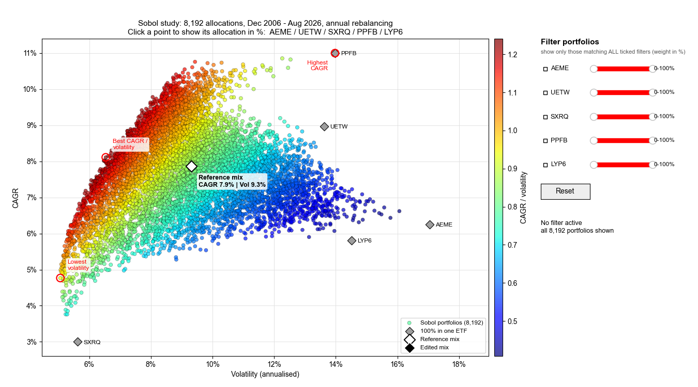

# portfolio-backtest

Backtest fixed-weight ETF portfolios on monthly EUR data, and explore thousands of allocations at once with an interactive Sobol study.

- **Vectorised engine.** Backtests thousands of portfolios in one pass, with no Python loop over portfolios or months. The results match a month-by-month simulation exactly; a test checks this.
- **Rebalancing:** none, monthly, quarterly, semiannual or annual.
- **Metrics:** final value, CAGR, annualised volatility and maximum drawdown.
- **Sobol study.** Samples allocations evenly over every possible mix of the chosen ETFs and plots them on a volatility vs CAGR chart. You can filter the points by weight per ETF, click a point to see its allocation, and compare any mix you type in.
- **Data straight from Curvo.** `portfolio-data` downloads the monthly EUR series from [Curvo Backtest](https://curvo.eu/backtest) through its MCP server and keeps them in an Excel workbook. Add any ETF Curvo knows by ticker or ISIN, and use it everywhere by its code.

## Install

Python 3.10 or newer.

```bash
git clone https://github.com/LorenzoNicoletti/portfolioAnalyzer.git
cd portfolioAnalyzer
pip install -e .            # add ".[qt]" for the "Custom mix" side panel, ".[dev]" for the tests
```

## Data

The price data is **not** in the repository; you download it yourself from Curvo Backtest. This needs internet access, but no account and no API key. The data comes from Curvo's public MCP server (`https://curvo.eu/backtest/mcp`), which is called with the `mcp` Python package; `pip install` installs it.

```bash
portfolio-data update                      # first run: creates data/Curvo_ETF_Monthly_EUR.xlsx with the six built-in ETFs
                                           # later runs: downloads every series again (new months)
portfolio-data add EUNL                    # add an ETF by ticker; its code is the ticker
portfolio-data add IE00B5BMR087=SP500I     # by ISIN (or ticker) with a code of your choice
portfolio-data list                        # the ETFs in the workbook and their codes
```

Each added ETF becomes a new column in the workbook's `Prices EUR` sheet and a new row in `Fund info`. From then on its code works in `--alloc`, `--etfs`, `--mix` and `--filter`. If a ticker is ambiguous or unknown on Curvo, the command lists the candidates; use the ISIN instead. [data/README.md](data/README.md) describes the workbook and where else it can live.

## Usage

### Backtest one portfolio

```bash
portfolio-backtest                                         # default mix (below), 10,000 EUR, annual rebalancing
portfolio-backtest --alloc WORLD=50 EM=10 BONDS=30 GOLD=10
portfolio-backtest --invest 25000 --rebalance none --start 2010-01 --end 2020-12
portfolio-backtest --no-plot                               # table only
```

This prints a table for the portfolio and each held ETF alone, then plots the value over time. Unless you give `--start`, the backtest starts in the first month in which every held ETF has data.

The default mix is the basis allocation EM 13 / WORLD 25 / SP500 10 / BONDS 20 / GOLD 10 / EUROPE 22 (`DEFAULT_ALLOC` in `src/portfolio_backtest/etfs.py`).

### Sobol study

```bash
portfolio-sobol                                            # 8192 mixes of EM, WORLD, BONDS, GOLD, EUROPE; default mix as the white diamond
portfolio-sobol --etfs WORLD BONDS GOLD --samples 4096
portfolio-sobol --etfs EUNL SP500I BONDS GOLD              # ETFs added with portfolio-data work too
portfolio-sobol --filter GOLD=10-30 --rebalance quarterly
portfolio-sobol --mix WORLD=50 BONDS=40 GOLD=10            # the white reference diamond
```



### From Python

```python
from portfolio_backtest import backtest, perform_backtest

r = backtest(10_000, {"WORLD": 50, "BONDS": 40, "GOLD": 10}, rebalance="annual")
print(r.cagr, r.volatility, r.max_drawdown)
r.values.plot()

# many portfolios at once: one row per portfolio, columns in the order of the ETF list
many = perform_backtest(10_000, ["WORLD", "BONDS"], [[60, 40], [80, 20], [100, 0]])
many.cagr, many.volatility

# extend the data from Python
from portfolio_backtest import add_etfs, update_all
add_etfs([("EUNL", None), ("IE00B5BMR087", "SP500I")])
```

## ETFs

| Code | ETF | ISIN |
|---|---|---|
| EM | Amundi Core MSCI Emerging Markets Acc | LU1437017350 |
| WORLD | UBS Core MSCI World USD acc | IE00BD4TXV59 |
| SP500 | Vanguard S&P 500 (USD) Acc | IE00BFMXXD54 |
| BONDS | iShares Euro Govt Bond 7-10yr (Acc) | IE00B3VTN290 |
| GOLD | iShares Physical Gold ETC | IE00B4ND3602 |
| EUROPE | Amundi Stoxx Europe 600 Acc | LU0908500753 |

These six are built in. Anywhere a code is accepted, the ISIN works too. To add an ETF, use `portfolio-data add` (see [Data](#data)); its code is stored in the workbook, so no code change is needed.

## How it works

Between two rebalancing dates, each portfolio is simply bought and held. If s(t) is the last rebalancing month before t, the value at month t is:

```
V(t) = V(s(t)) · Σᵢ wᵢ · Pᵢ(t) / Pᵢ(s(t))
```

At each rebalancing date, the value is the running product of the growth over each finished period. All of this is matrix operations over (months × ETFs) and (portfolios × ETFs).

The Sobol allocations work like this: take a scrambled Sobol point u in [0,1)ᵈ, compute e = −ln(1−u), and set w = 100·e/Σe. This spreads the points evenly over every possible mix.

## Project layout

```
src/portfolio_backtest/
  etfs.py        ETF registry (built-in + added), default allocation, allocation parsing and validation
  data.py        reading and writing the data workbook
  curvo.py       Curvo MCP client: add ETFs, refresh series
  engine.py      vectorised backtest and metrics
  plotting.py    single-portfolio chart and style helpers
  cli.py         portfolio-backtest command
  data_cli.py    portfolio-data command
  sobol/
    study.py     Sobol sampling and batch backtest
    explorer.py  interactive chart (filters, click labels, custom-mix panel)
    cli.py       portfolio-sobol command
tests/           pytest; uses synthetic prices and a fake Curvo client, so no data file or network is needed
```

## Tests

```bash
pip install -e ".[dev]"
pytest
```

## Disclaimer

The data is Curvo's simulation from each index minus the fund's TER, not actual fund prices. Past performance does not guarantee future results. This is a personal analysis tool, not investment advice.
